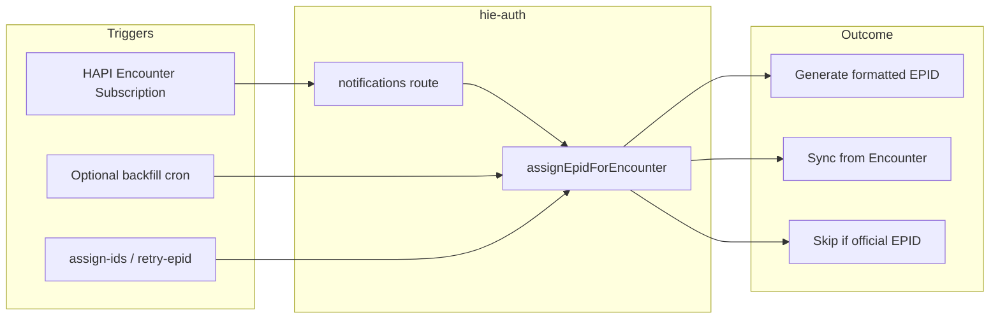

# EPID (Epidemiological ID) — how it is assigned

## Short answer

EPID is **not** created implicitly by saving a Patient or Encounter in FHIR. It **is** generated when `assignEpidForEncounter` runs via the Encounter subscription, optional backfill cron, or manual endpoints—subject to preconditions and configuration. The FHIR server does not mint EPIDs by itself.

## How automatic generation happens

1. **Encounter REST-hook subscription (primary automatic path)**  
   On startup, [`src/index.ts`](../src/index.ts) calls `createFHIRSubscription()`, which registers a HAPI `Subscription` for `Encounter?` if both env vars are set: `FHIR_EPID_SUBSCRIPTION_ID` and `FHIR_ENCOUNTERS_SUBSCRIPTION_CALLBACK_URL` ([`src/lib/fhir-subscriptions.ts`](../src/lib/fhir-subscriptions.ts)). If either is missing, EPID subscription setup logs and skips—no automatic EPID path from subscriptions.

2. **Handler**  
   `PUT /subscriptions/encounters/notifications/Encounter/:id` ([`src/routes/subscriptions.ts`](../src/routes/subscriptions.ts)) loads the Encounter + Patient, skips if the Patient already has an **official** EPID (simple `Identifier.system`, or typed `Identifier.type.coding` with `system === http://hie.org/identifiers/EPID`, with `use === 'official'` — [`src/lib/epid-utils.ts`](../src/lib/epid-utils.ts)), otherwise calls `assignEpidForEncounter`.

3. **What `assignEpidForEncounter` does** ([`src/lib/epid-assignment.ts`](../src/lib/epid-assignment.ts))  
   - **Skip**: Patient already has official EPID → no new ID.  
   - **Sync (not generate)**: Encounter already carries an EPID identifier → copy to Patient.  
   - **Generate**: Builds `formattedId` from reason code, location chain (Observation `a3-sub-county` → resolve `Location` by `name` and `type=SUB-COUNTY` → county/country), year (from Patient `system-creation` identifier, else fallbacks), and `generateCaseId` ([`src/lib/caseIdTracker.ts`](../src/lib/caseIdTracker.ts)) → then PUT Patient + PUT Encounter with the new identifier.

4. **Optional cron backfill**  
   [`src/lib/schedule.ts`](../src/lib/schedule.ts) runs `runEncounterBackfillJob()` only when `ENCOUNTER_BACKFILL_CRON_ENABLED === 'true'`. Same assignment logic as above.

5. **Manual**  
   `POST /subscriptions/encounters/assign-ids` and `POST /subscriptions/encounters/retry-epid` (internal API key) also invoke the same logic.

## When it will not be generated automatically

- Subscription env vars unset → no EPID subscription → no automatic generation on Encounter events.  
- Patient already has **official** EPID → skipped.  
- If the generate path runs but location/Observation/FHIR calls fail, `assignEpidForEncounter` returns **error** (no successful EPID).  
- Creating resources without triggering the subscription callback (or manual/backfill paths) → no EPID unless another path runs.

## Location edge case: same county and sub-county name

Some Kenyan locations have a county and a sub-county with the same display name. Examples:

- GARISSA
- ISIOLO
- MACHAKOS
- MAKUENI
- NYAMIRA
- VIHIGA
- WEST POKOT

For these, searching only by `Location?name={value}` can return county first. EPID generation now prioritizes:

1. `Location?name={value}&type=http://terminology.hl7.org/CodeSystem/v3-RoleCode|SUB-COUNTY`
2. Fallback to by-name results filtered to `type=SUB-COUNTY`
3. Last-resort first match (to avoid hard break on unusual data)

This avoids selecting county when the `a3-sub-county` Observation points to a same-named sub-county.

## Client-side EPID Observation note

Some clients may submit an Observation with `code=EPID` and a partial value. This is **not authoritative** for assignment.

Server-side assignment in `hie-auth` is driven by:

- existing EPID on `Encounter.identifier` (sync path), or
- generated EPID written to `Patient.identifier` and `Encounter.identifier`.

## Flow (high level)

**Conclusion:** EPID is automatically generated (or synced) when the configured subscription fires and preconditions pass; it is not guaranteed for every Encounter unless that pipeline is configured and succeeds.
